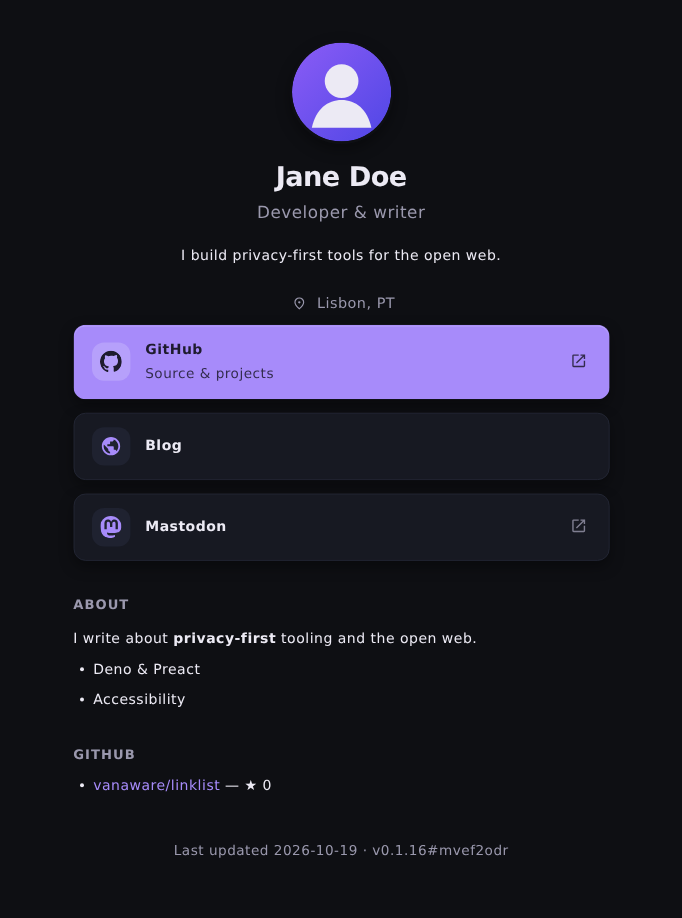
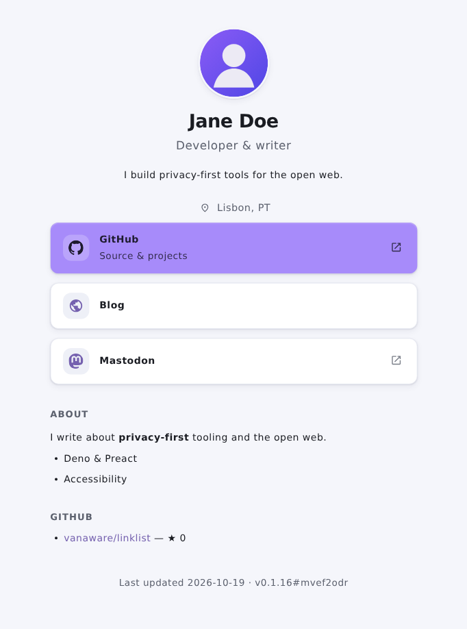

# @vanaware/linklist 🔗

> A link-in-bio site generator: describe yourself in a single `config.json` and get a
> fast, accessible, private, static page you can host anywhere (GitHub Pages, Netlify,
> Vercel, Cloudflare Pages, Nginx…). Built on Deno, Preact + Signals, and BeerCSS
> (Material Design 3).

[](LICENSE)
[](https://deno.com)

---

## 🌟 Highlights

- **One file, whole page**: everything — profile (identity + head metadata), the ordered
  `blocks` flow (links as rows/buttons/cards, Markdown sections and figures),
  theme, footer — lives in a versioned `config.json`, validated with
  [ArkType](https://arktype.io).
- **Static head + client-rendered body**: the build bakes the per-profile SEO `<head>`
  (title / OG / Twitter / JSON-LD) and the PWA `manifest.json` into a real `index.html`,
  while `linklist.js` fetches `./config.json` at runtime, applies
  the theme and renders the Preact app. Crawlers and link previews see the metadata without JS.
  Paths are relative, so it works at a domain root **or** a subfolder.
- **100% Pure Deno**: no Node runtime and no `node_modules` workflow. The static build is
  declarative via [`@vanaware/buildit`](https://jsr.io/@vanaware/buildit)
  (`scripts/esbuild.jsonc` / `scripts/denobuild.jsonc`); a small Cliffy CLI in core
  (`packages/core/src/cli.ts`) generates the site files and validates configs.
- **BeerCSS themes**: presets (`minimal-dark`, `light-simple`) selectable via
  `config.theme.preset`, with token overrides (colors, radius, shadow, font).
- **Rich text where you want it**: Markdown (CommonMark + GFM) in the bio, tagline,
  section bodies, link subtitles and footer — rendered to real Preact VNodes, no
  `dangerouslySetInnerHTML`.
- **Private by default**: no analytics or click tracking — there is none to opt into.

---

## 🚀 Quick start

### Requirements

- [Deno 2.x](https://deno.com) (pinned in `.tool-versions`).

### Edit your config

Start from a template: `docs/templates/minimal.config.json` (bare-bones) or
`packages/core/public/config.json` (the fully-annotated sample that powers the official
site). The shape mirrors `packages/core/src/lib/types.ts`, with the JSON Schema at
`packages/core/schema/config.schema.json` (published at
`https://vanaware.github.io/linklist/config.schema.json`).

```bash
git clone https://github.com/vanaware/linklist.git
cd linklist

# Copy a starter and edit it
cp packages/core/public/config.json site/config.json

# Validate your config at any time
deno task validate-config site/config.json
```

### Preview locally

```bash
deno task dev        # build, then serve packages/server/build/dist
```

Open the URL the server prints. (See [Building](#-build) for the sandbox fallback.)

---

## 🏗️ Build

The build is entirely driven by buildit config files — first `deno task linklist:build`
regenerates `index.html` / `manifest.json` / `robots.txt` (SEO head baked in) into
`packages/core/public`, then the bundler cleans the output dir, copies the static assets

- theme CSS + `config.json`, and bundles `core/src/entry.ts` → `linklist.js`:

| Task                       | Engine                  | Output                       | Notes                                                          |
| -------------------------- | ----------------------- | ---------------------------- | -------------------------------------------------------------- |
| `deno task esbuild`        | **esbuild** (preferred) | `packages/server/build/dist` | Dev bundle; runs `linklist:build` first.                       |
| `deno task denobuild`      | Deno in-process bundler | `packages/server/build/dist` | Fallback for sandboxes where esbuild's subprocess can't spawn. |
| `deno task linklist:build` | core CLI (`src/cli.ts`) | `packages/core/public`       | Site-file codegen only (chained by the tasks above).           |

> ⚠️ **Local sandbox note**: on some locked-down containers esbuild's npm subprocess
> cannot start (`ChildProcess.unref` undefined). There, use `deno task denobuild` (Deno's
> own in-process bundler) to produce `linklist.js`, then `deno task dev`. CI runners
> build with esbuild normally.

Everything above is wrapped by one command, which builds and then serves the output
with the static server:

```bash
deno task dev        # denobuild + packages/server file-server (port from packages/server/.env)
```

---

## 🎨 Theming

```jsonc
{
  "theme": {
    "preset": "minimal-dark", // a CSS file from packages/core/themes
    "mode": "auto", // light | dark | auto
    "custom": { "primary_color": "#6750a4", "radius": "16px" } // token overrides
  }
}
```

Add a preset by dropping a `<name>.css` in `packages/core/themes` — it is copied into the
build automatically.

| `minimal-dark`                                                        | `light-simple`                                                        |
| --------------------------------------------------------------------- | --------------------------------------------------------------------- |
|  |  |

Presets are responsive (one column on phones, a two-column card grid on desktops) and
ship with contrast guards: a custom `primary_color` automatically derives a readable
button ink and a AA-legible link tint per background. See [docs/theming.md](docs/theming.md).

---

## 📁 Repository structure

```
├── packages/
│   ├── core/                   # @vanaware/linklist (the engine)
│   │   ├── src/
│   │   │   ├── mod.ts          #   public API surface (side-effect-free)
│   │   │   ├── entry.ts        #   browser bootstrap -> bundled linklist.js
│   │   │   ├── cli.ts          #   build + validate CLI (Cliffy; the file-writing edge)
│   │   │   ├── version.ts      #   build-stamped APP_VERSION (generated)
│   │   │   ├── lib/            #   pure engine: types, schema, theme, seo, generate
│   │   │   └── components/     #   Preact UI + signals + markdown renderer
│   │   ├── schema/             #   config.schema.json (published for editors + the site)
│   │   ├── themes/             #   BeerCSS theme presets (minimal-dark, light-simple)
│   │   └── public/             #   index.html shell, config.json, manifest, favicon, robots
│   └── server/                 # static file-server (serveDir) used for local preview
├── scripts/                    # buildit configs + export/version tooling (I/O edge)
├── .github/workflows/          # ci.yml (gate) + pages.yml (build & deploy)
└── deno.jsonc                  # workspace + tasks
```

---

## 🧪 Testing & verification

```bash
deno task tests      # check:all + lint + fmt:check + test (the full gate)
deno task test       # BDD tests (@std/testing/bdd + @std/assert) only
```

---

## 🌐 Deploy

- **GitHub Pages**: push a `v*.*` tag (or run the workflow manually). `pages.yml` runs the
  gate, builds the site into `packages/server/build/dist`, and publishes it. The site uses
  relative paths, so a project-page subfolder works out of the box.
- **Any static host**: run `deno task esbuild` (or `denobuild`) and upload
  `packages/server/build/dist` — it is fully self-contained.
- **Custom domain**: point DNS at your host and add a `CNAME`; never hardcode base paths.

---

## 📚 Documentation

Full guides live in [`docs/`](docs):

- [Getting started](docs/guide.md)
- [Configuration reference](docs/configuration.md)
- [Theming](docs/theming.md)
- [Deploy](docs/deploy.md)
- [API reference](docs/api-reference.md)
- [Site templates](docs/templates/README.md) — starter `config.json` files

Contributing? Read the architectural rules in [AGENTS.md](AGENTS.md). For current
status and the next milestone, see [CURRENT.md](CURRENT.md).

---

## 📄 License

MIT © [Vanaware](https://github.com/vanaware)
